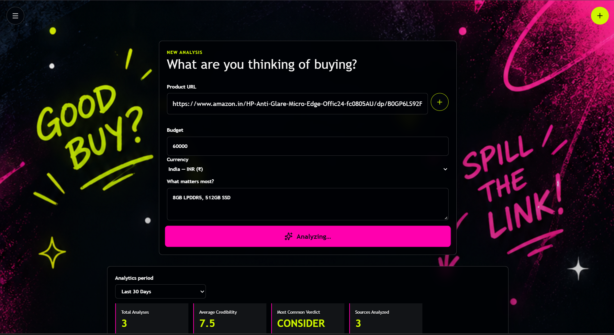
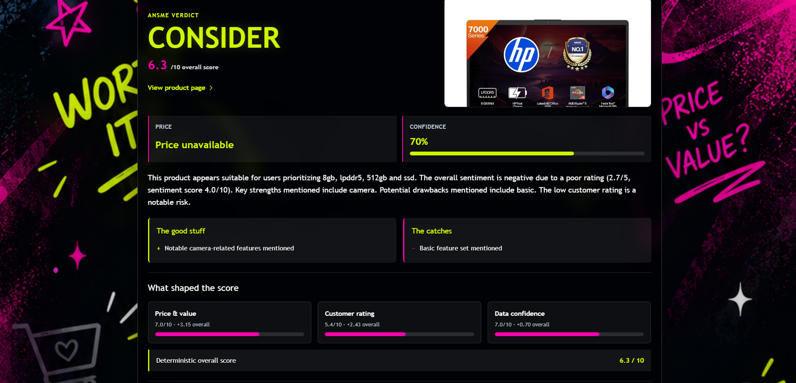
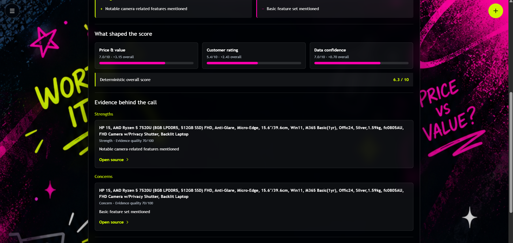
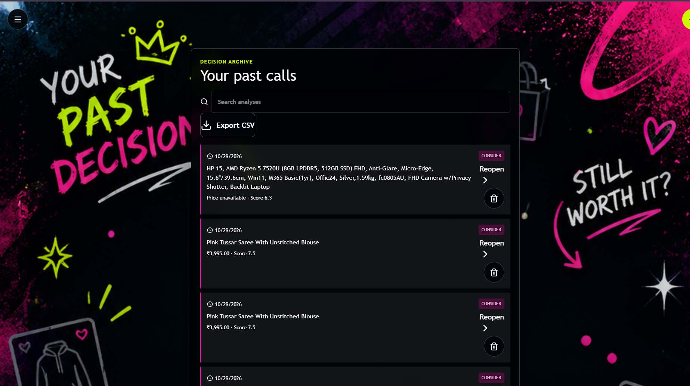
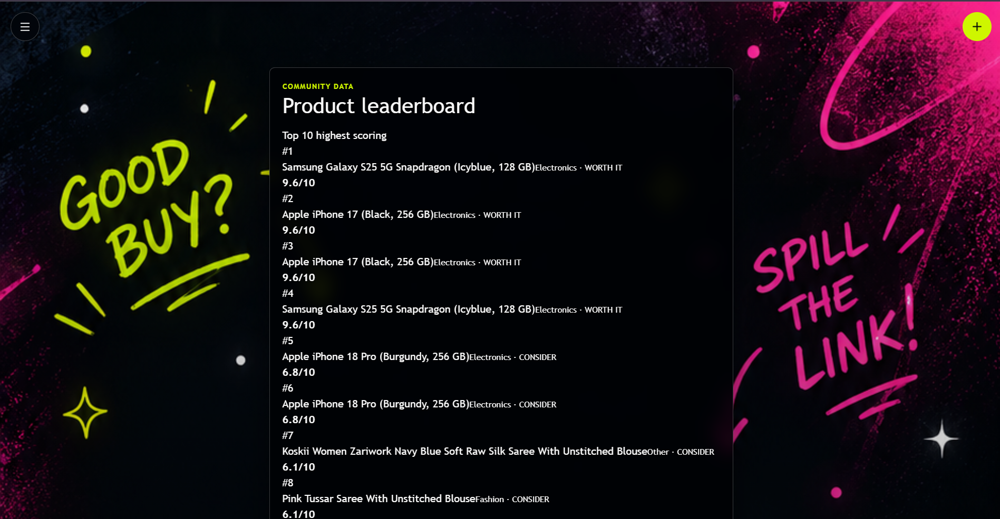
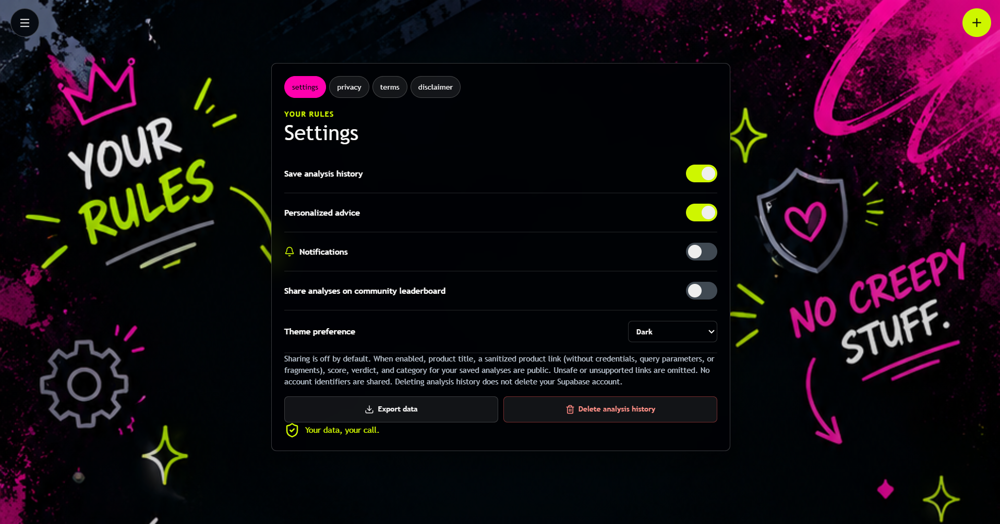
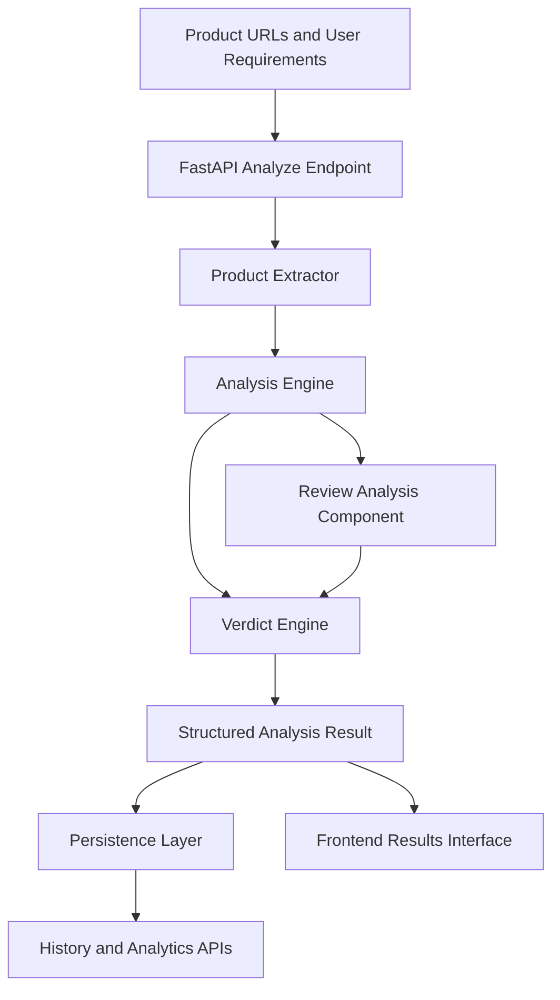
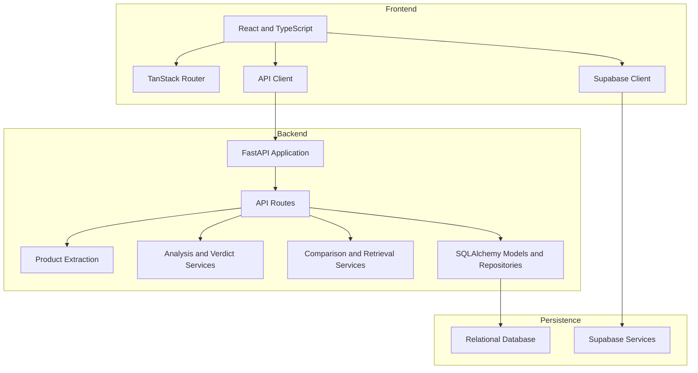

# ANSME — Product Research & Decision Engine

<p align="center">
  
</p>

<h1 align="center">ANSME</h1>

<p align="center">
  <strong>Don't Buy Dumb Stuff.</strong>
</p>

<p align="center">
  <a href="https://ansme-five.vercel.app/"><strong>🚀 Live Application</strong></a>
  &nbsp; · &nbsp;
  <a href="https://github.com/zmuskan/ANSME"><strong>GitHub Repository</strong></a>
</p>

<p align="center">
  An evidence-oriented product research and decision-support platform that helps users evaluate products, understand trade-offs, and make more informed purchasing decisions.
</p>

---

## Table of Contents

- [Problem Statement](#problem-statement)
- [Overview](#overview)
- [Application Walkthrough](#application-walkthrough)
- [Core Features](#core-features)
- [Analysis Pipeline](#analysis-pipeline)
- [Scoring and Verdicts](#scoring-and-verdicts)
- [Evidence and Review Analysis](#evidence-and-review-analysis)
- [System Architecture](#system-architecture)
- [Backend API](#backend-api)
- [Database Design](#database-design)
- [Technology Stack](#technology-stack)
- [Project Structure](#project-structure)
- [Getting Started](#getting-started)
- [Environment Configuration](#environment-configuration)
- [Current Limitations](#current-limitations)
- [Roadmap](#roadmap)
- [Author](#author)

---

## Problem Statement

Online shopping provides access to thousands of products, but deciding what to buy requires more than reading a product title or looking at its star rating. Buyers must evaluate specifications, price, requirements, customer feedback, and potential trade-offs across different sources.

Product ratings alone do not establish whether an item is suitable for a particular buyer. Incomplete product information and limited access to customer reviews can also make comparisons unreliable.

**ANSME approaches purchasing as a structured decision problem:** collect available product information, evaluate relevant signals, generate an interpretable verdict, and communicate the strengths, concerns, and limitations that influence a purchase decision.

## Overview

ANSME is a full-stack web application built with a React and TypeScript frontend and a Python FastAPI backend.

Its backend separates product extraction, analysis, verdict generation, comparison, explanation, evidence retrieval, and persistence into dedicated modules.

The application brings these components together in a workflow that allows users to:

- Submit product URLs and purchasing constraints.
- Inspect a structured product-analysis result.
- Review the generated verdict, score breakdown, strengths, and concerns.
- Compare product analyses.
- Revisit previous decisions through analysis history.
- Explore community leaderboard data and manage application preferences.

The design emphasizes modular backend services and explainable, decision-oriented outputs rather than presenting a product recommendation as an unexplained score.

---

## Application Walkthrough

The following screenshots are from the deployed application.

### 1. Authentication

The entry screen provides Google sign-in and guest access.

<p align="center">
  
</p>

### 2. Product Analysis Workspace

Submit a product URL, specify a budget and currency, and describe the requirements that matter most to you.

<p align="center">
  
</p>

### 3. Product Verdict and Score

The results interface presents a verdict, overall score, product information, confidence indicator, and a written explanation of the analysis.

<p align="center">
  
</p>

### 4. Score Breakdown and Evidence

The detailed result view displays score components and evidence entries grouped into strengths and concerns, with links to their reported source.

<p align="center">
  
</p>

### 5. Decision History

Search previous analyses, reopen results, export history to CSV, and remove individual history entries.

<p align="center">
  
</p>

### 6. Product Leaderboard

Explore the leaderboard of products and their recorded scores and verdicts.

<p align="center">
  
</p>

### 7. Settings and Privacy

Manage application preferences, including history, personalized advice, notifications, leaderboard sharing, and theme selection. The interface also provides data export and history deletion controls.

<p align="center">
  
</p>

---

## Core Features

### Product Extraction

The `product_extractor` service retrieves and parses product information from submitted URLs.

The extraction implementation uses HTTP requests, HTML parsing, and content-extraction libraries to process available page data. Successful extraction depends on the structure and accessibility of the source website.

### Structured Product Analysis

The `analysis_engine` evaluates extracted product attributes and user requirements to generate structured analysis outputs, including score-related signals, strengths, and concerns.

### Verdict Generation

The `verdict_engine` produces a decision-oriented verdict from the available analysis data. The result is presented alongside the overall score and explanatory information.

### Product Comparison

The `comparison_engine` contains deterministic rules for comparing analyzed products using available information, including price, requirements, ratings, review-related signals, and overall scores.

### Evidence Retrieval

The `retrieval_engine` ranks supplied text according to keyword overlap with a query. This provides a lightweight retrieval mechanism for finding potentially relevant evidence.

### Review Analysis

The `review_analysis_engine` processes review text supplied to it using deterministic lexical sentiment signals. This component is distinct from the product-page extractor: its existence does not mean that customer reviews are automatically collected from every shopping website.

### Analysis History and Analytics

Dedicated API routes support analysis history, analytics, and leaderboard functionality. The frontend includes history search, CSV export, result reopening, and deletion controls.

### Authentication and Preferences

The frontend includes Google sign-in and guest access flows, Supabase client integration, and user-facing settings for application preferences.

---

## Analysis Pipeline

ANSME separates the product-analysis workflow into modular stages.



### Pipeline stages

1. **Input collection** — receive product URLs, budget information, currency, and user requirements.
2. **Product extraction** — retrieve and parse available product-page information.
3. **Analysis** — evaluate the extracted attributes and available textual signals.
4. **Review analysis** — process review text when it is available to the review-analysis component.
5. **Verdict generation** — produce a structured, decision-oriented result from the available analysis.
6. **Persistence and presentation** — store supported analysis data and expose results through the API and frontend.

The pipeline is implemented as application services rather than a trained end-to-end machine-learning model. Its output quality depends on extraction reliability, available evidence, and the current deterministic analysis rules.

---

## Scoring and Verdicts

The results interface displays a verdict, an overall score, a confidence indicator, and a breakdown of contributing score components.

The comparison service also implements explicit decision rules rather than relying on an opaque model to compare two products.

These concepts should be interpreted separately:

| Component | Purpose |
|---|---|
| Overall score | Summarizes the current scoring logic |
| Verdict | Communicates the decision category produced by the verdict engine |
| Score breakdown | Shows the displayed contributions of scoring components |
| Confidence indicator | Represents the confidence value provided by the current implementation |
| Evidence entries | Present the supporting text and explanations returned by the analysis pipeline |

The current implementation has known limitations in how evidence quality, review availability, and confidence are represented. These are important areas for further calibration and testing.

---

## Evidence and Review Analysis

ANSME contains separate components for review analysis and evidence retrieval.

The review-analysis component uses lexical sentiment signals to analyze text supplied to it. The retrieval component ranks supplied text by keyword overlap with a query.

These are lightweight, deterministic approaches. They are not equivalent to a trained sentiment classifier or embedding-based semantic search.

The reliability of the resulting analysis depends on whether the input text represents genuine, relevant product evidence.

An important design principle for future improvements is to distinguish **product quality from confidence in the available evidence**. Missing reviews or incomplete product data should not automatically be interpreted as negative product quality; instead, the result should communicate what is known and what remains uncertain.

---

## System Architecture

ANSME uses a frontend/backend architecture with dedicated API routes, service modules, SQLAlchemy models, and repository classes.



### Frontend

The frontend is built with React, TypeScript, Vite, and TanStack's routing and application tooling. It contains dedicated routes for the workspace, analysis progress, results, comparison, history, leaderboard, and settings.

### Backend

FastAPI exposes the application endpoints. Business logic is organized into independent service modules, while SQLAlchemy models and repository classes handle database persistence.

### Persistence

The backend uses SQLAlchemy and a PostgreSQL driver for relational database access. The frontend also includes a Supabase JavaScript client for configured managed services and authentication-related functionality.

### Deployment

The frontend is deployed on Vercel:

- **Live application:** https://ansme-five.vercel.app/
- **Source repository:** https://github.com/zmuskan/ANSME

The backend uses a separately configurable API deployment and database connection.

---

## Backend API

The backend organizes endpoints into dedicated route modules.

| Module | Responsibility |
|---|---|
| `api/analyze.py` | Product analysis workflow |
| `api/health.py` | Health-check endpoint |
| `api/history.py` | Analysis history operations |
| `api/analytics.py` | Analytics endpoints |
| `api/leaderboard.py` | Leaderboard endpoints |

The main FastAPI application is initialized in `app/main.py`. The service layer is separated from route handlers to keep extraction and analysis logic modular.

When running locally, the generated API documentation is available through FastAPI's interactive documentation interface at `/docs`.

---

## Database Design

The backend uses SQLAlchemy models and repository classes to separate data persistence from analysis logic.

The current model layer includes:

| Model | Responsibility |
|---|---|
| `Analysis` | Product-analysis records and associated result data |
| `Evidence` | Evidence records |
| `PriceHistory` | Price-history data |
| `UserPreference` | User-level application preferences |

Corresponding repository modules provide data-access functionality for analyses, evidence, price history, and user preferences.

Database changes are tracked through SQL migration files in `backend/migrations/`.

The database engine and connection settings are configured through the backend environment. The actual schema and available data depend on the configured database and applied migrations.

---

## Technology Stack

The following stack is based on the project's source files and dependency manifests.

| Layer | Technologies |
|---|---|
| Frontend Framework | React 19, TypeScript |
| Build Tool | Vite 8 |
| Application Framework | TanStack Start |
| Routing | TanStack Router |
| Server State | TanStack React Query |
| UI Components | Radix UI, custom UI components |
| Styling | Tailwind CSS 4, `tw-animate-css` |
| Icons | Lucide React |
| Forms | React Hook Form, `@hookform/resolvers` |
| Validation | Zod, Pydantic |
| Charts | Recharts |
| Animations | Motion |
| Frontend Utilities | `clsx`, `tailwind-merge`, `class-variance-authority` |
| Frontend Authentication and Services | Supabase JavaScript client |
| Backend Framework | Python, FastAPI |
| ASGI Server | Uvicorn |
| HTTP Client | HTTPX |
| HTML Parsing | Beautiful Soup 4, lxml |
| Content Extraction | Trafilatura, jusText |
| HTML Cleanup | `lxml_html_clean` |
| Date and Text Processing | `dateparser`, `htmldate`, `courlan`, `tld`, `regex` |
| Data Validation | Pydantic 2 |
| ORM | SQLAlchemy 2.x |
| Database Driver | psycopg2-binary |
| Configuration | python-dotenv |
| Database Migrations | SQL migration scripts |
| Testing | pytest dependency/tooling where configured |
| Frontend Quality Tools | ESLint, Prettier, TypeScript ESLint |
| Deployment | Vercel frontend; separately configured backend hosting |

**Implementation note:** The frontend uses a substantial component library and a modular route structure. The backend's extraction and analysis logic is implemented in Python. The current pipeline uses deterministic analysis and retrieval logic; the dependency manifests do not establish that a trained ML model, embedding-based retrieval pipeline, or LLM-powered recommendation engine is implemented.

---

## Project Structure

```text
ANSME/
│
├── backend/
│   ├── app/
│   │   ├── api/
│   │   │   ├── analyze.py
│   │   │   ├── analytics.py
│   │   │   ├── health.py
│   │   │   ├── history.py
│   │   │   └── leaderboard.py
│   │   ├── db/
│   │   │   └── database.py
│   │   ├── models/
│   │   │   ├── analysis.py
│   │   │   ├── evidence.py
│   │   │   ├── price_history.py
│   │   │   └── user_preference.py
│   │   ├── repositories/
│   │   │   ├── analysis_repository.py
│   │   │   ├── evidence_repository.py
│   │   │   ├── price_history_repository.py
│   │   │   └── user_preference_repository.py
│   │   ├── schemas/
│   │   │   └── analyze.py
│   │   ├── services/
│   │   │   ├── product_extractor.py
│   │   │   ├── analysis_engine.py
│   │   │   ├── review_analysis_engine.py
│   │   │   ├── verdict_engine.py
│   │   │   ├── comparison_engine.py
│   │   │   ├── retrieval_engine.py
│   │   │   └── explanation_engine.py
│   │   ├── auth.py
│   │   └── main.py
│   ├── migrations/
│   ├── tests/
│   ├── requirements.txt
│   └── Dockerfile
│
├── frontend/
│   ├── public/
│   │   ├── auth.png
│   │   ├── enquiry.png
│   │   ├── result1.png
│   │   ├── result2.png
│   │   ├── history.png
│   │   ├── leaderboard.png
│   │   └── settings.png
│   ├── src/
│   │   ├── assets/
│   │   ├── components/
│   │   │   └── ui/
│   │   ├── hooks/
│   │   ├── lib/
│   │   │   ├── api.ts
│   │   │   ├── ansme.tsx
│   │   │   ├── auth.ts
│   │   │   └── supabase.ts
│   │   ├── routes/
│   │   │   ├── auth.tsx
│   │   │   ├── workspace.tsx
│   │   │   ├── analyzing.tsx
│   │   │   ├── result.tsx
│   │   │   ├── comparison.tsx
│   │   │   ├── history.tsx
│   │   │   ├── leaderboard.tsx
│   │   │   └── settings.tsx
│   │   ├── router.tsx
│   │   ├── server.ts
│   │   └── styles.css
│   └── package.json
│
└── README.md
```

---

## Getting Started

### Prerequisites

- Python compatible with the backend's pinned dependencies; Python 3.12 is used in the development environment.
- Node.js compatible with the project's Vite and TanStack tooling.
- npm.
- A configured relational database.
- Supabase project configuration if using the associated frontend services.

### 1. Clone the repository

```bash
git clone https://github.com/zmuskan/ANSME.git
cd ANSME
```

### 2. Set up the backend

```powershell
cd backend
python -m venv .venv
.\.venv\Scripts\Activate.ps1
pip install -r requirements.txt
```

Create a local `.env` file using `backend/.env.example` as a reference. Populate the required database and application settings with your own values.

Start the API from the `backend` directory:

```bash
uvicorn app.main:app --reload --port 8000
```

Open the API documentation at:

http://localhost:8000/docs

### 3. Set up the frontend

Open a separate terminal at the repository root:

```powershell
cd frontend
npm install
```

Create a local `.env` file based on `frontend/.env.example` and configure the API base URL and required Supabase settings using the variable names defined in the project.

Start the development server:

```bash
npm run dev
```

Use the local URL printed by Vite.

### 4. Build and lint the frontend

From the `frontend` directory:

```bash
npm run build
npm run lint
```

The build command compiles the frontend for deployment. The lint command runs the project's configured ESLint checks.

> **Configuration note:** The commands above describe the intended local workflow. Database availability, environment variables, authentication providers, and backend hosting must be configured before every application feature can run successfully.

---

## Environment Configuration

ANSME uses environment-based configuration so local credentials are not hardcoded into source files.

- `backend/.env.example` documents the backend's expected configuration.
- `frontend/.env.example` documents the frontend's expected configuration.

Create your local `.env` files from these examples and populate them with your own development credentials.

**Never commit `.env`, `.env.local`, database passwords, service-role keys, or other private credentials to GitHub.** Frontend-exposed environment variables are not secret simply because they are stored in an environment file.

---

## Current Limitations

ANSME is an actively developed application. Several areas require additional validation before the results can be treated as comprehensive purchasing advice.

- **Source-dependent extraction:** Product pages vary in HTML structure, metadata, accessibility, and anti-bot behavior.
- **Review coverage:** Customer review text is not guaranteed to be extracted from every product page.
- **Deterministic text analysis:** Lexical sentiment signals can miss negation, context, sarcasm, and domain-specific language.
- **Keyword-based retrieval:** Keyword overlap does not provide the semantic understanding of embedding-based retrieval.
- **Requirement verification:** Textual matching should not be interpreted as independent verification of every product specification.
- **Confidence calibration:** The confidence indicator requires further validation against evidence completeness and extraction reliability.
- **Score evaluation:** The scoring policy should be tested against curated examples and real product evidence to measure consistency.

These limitations are part of the next engineering phase: improving extraction reliability, traceability, missing-data handling, and the calibration of decision outputs.

## Roadmap

- Improve product extraction across more e-commerce websites.
- Add diagnostics for missing fields, blocked pages, and failed extraction stages.
- Improve access to actual customer review text and its source attribution.
- Make strengths, concerns, and evidence snippets traceable to their underlying sources.
- Separate product quality from confidence in the available evidence.
- Improve verdict behavior when product data is incomplete or incomparable.
- Expand automated tests for extraction, scoring, comparison, and failure handling.
- Evaluate the analysis pipeline against a curated product dataset.
- Improve frontend error states and communicate uncertainty more clearly.

---

## Author

**Zaiba Muskan**

- **GitHub:** [github.com/zmuskan](https://github.com/zmuskan)
- **LinkedIn:** [Zaiba Muskan](https://www.linkedin.com/in/zaiba-muskan-dm-983055388/)
- **Live Application:** [ANSME](https://ansme-five.vercel.app/)
- **Repository:** [zmuskan/ANSME](https://github.com/zmuskan/ANSME)

